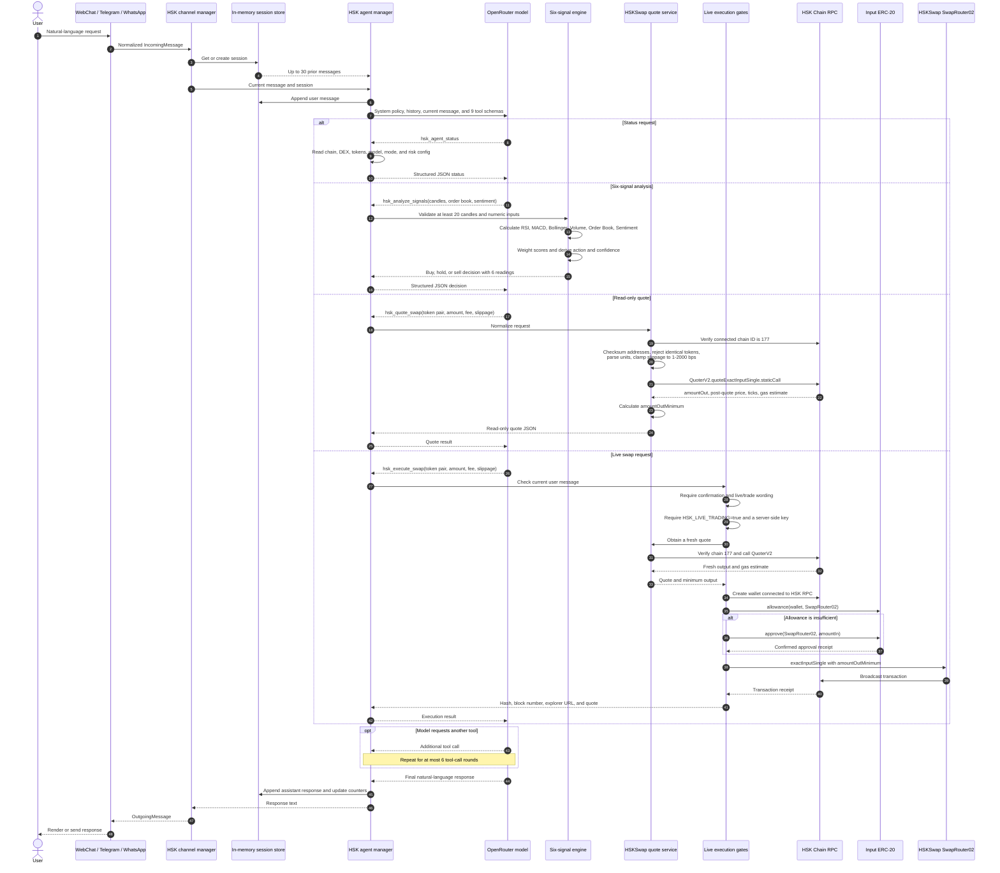
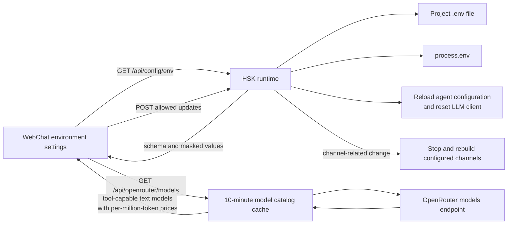

# Clodds HSK — AI Trading Agent 

> An autonomous AI trading agent platform with deterministic execution safeguards and HSKSwap infrastructure.

Clodds HSK is an OpenRouter-powered AI agent for decentralized trading on [HSKSwap](https://app.hskswap.com/?lng=en-US), operating exclusively on HSK Chain Mainnet. It provides the core infrastructure for a closed-loop trading workflow: consume market observations, analyze on-chain and technical data, combine trading signals, request executable DEX quotes, apply safety gates, and submit on-chain swaps.

The system also exposes a natural-language interface through WebChat, Telegram, and WhatsApp. Users can inspect the agent and network, request six-signal analysis, obtain dry-run quotes, select an OpenRouter model by token cost, and change supported strategy and risk settings without restarting or refreshing the application.

Trading signals are probabilistic. This project does not promise sustained profitability, risk-free arbitrage, or guaranteed returns.

## Product objective

The long-term objective is a continuously operating AI trading system that can:

1. Monitor HSKSwap and relevant HSK Chain state.
2. Analyze technical, liquidity, order-book, and sentiment data.
3. Identify spreads, arbitrage candidates, and directional opportunities.
4. Convert observations into explainable trading decisions.
5. Apply deterministic portfolio and execution risk controls.
6. Quote and execute approved swaps on HSKSwap.
7. Report positions, realized and unrealized P&L, and risk utilization through conversation.
8. Let users adjust position sizing, trading frequency, risk appetite, and target assets in natural language.

This creates a human-controllable agent architecture: AI handles analysis and execution orchestration while explicit policies define what it may trade and how much risk it may take.

## Current implementation

| Requirement | Status | Implementation |
|---|---|---|
| HSK Chain Mainnet only | Implemented | Chain ID `177`, validated RPC, HSK explorer, and HSK-native configuration |
| HSKSwap-only execution | Implemented | Pinned V3 factory, QuoterV2, SwapRouter02, and position-manager contracts |
| OpenRouter LLM core | Implemented | Conversational tool orchestration through the OpenRouter Messages API |
| Cost-aware model selection | Implemented | Live compatible-model catalog with input/output cost per million tokens, search, sorting, and instant activation |
| Six-signal analysis | Implemented | RSI, MACD, Bollinger Bands, Volume, Order Book imbalance, and Sentiment |
| Explainable decisions | Implemented | Buy/hold/sell result with per-signal state, composite score, confidence, and rationale |
| Read-only DEX quotes | Implemented | Exact-input HSKSwap V3 quoting with fee tier, slippage, output minimum, and gas estimate |
| On-chain swap execution | Implemented | ERC-20 allowance handling and HSKSwap exact-input transaction submission |
| Deterministic execution gates | Implemented | Chain validation, live-mode gate, current-message confirmation, token validation, and bounded slippage |
| Natural-language UI | Implemented | WebChat plus Telegram and WhatsApp adapters |
| Hot configuration | Implemented | Settings auto-save and apply without a process restart or browser refresh |
| Continuous HSKSwap ingestion | Implemented | Checkpointed V3 `Swap` event indexer, one-minute candle builder, bounded polling, and durable market state |
| Price-spread discovery | Implemented | Fresh comparable-pool groups are ranked by net spread after configured execution-cost estimates |
| Unattended strategy scheduling | Implemented, opt-in | Persistent cadence, pair, size, confidence, risk, slippage, fee-tier, live/dry-run, and asset-allowlist controls |
| Persistent sessions | Implemented | Conversation history, titles, preferences, and model overrides survive process restarts |
| Persistent positions and P&L | Implemented | Durable fills, swaps, cost basis, realized P&L, marked unrealized P&L, and transaction receipts |
| Portfolio risk enforcement | Implemented | Fail-closed USD valuation, maximum-position, daily-loss, signal-confidence, stop-loss, allowlist, and persistent kill-switch gates |
| Conversational portfolio and strategy controls | Implemented | Agent tools expose portfolio/P&L, opportunities, strategy inspection/update, and kill-switch control |

“Implemented” means the code path and automated tests exist. Autonomous live deployment still requires operator-supplied pool metadata, independent mark prices, a verified portfolio value, an allowlist, a dedicated wallet, and explicit enabling of both live and autonomous modes. No software implementation can guarantee sustained profitability.

## System architecture

The production entry point is `src/hsk/runtime.ts`. It starts one lightweight process containing the HTTP API, WebSocket server, channel adapters, durable sessions, HSKSwap event indexer, portfolio ledger, risk manager, strategy scheduler, and OpenRouter agent. The larger legacy modules elsewhere under `src/` are retained as reference code, but they are outside the active HSK build graph defined by `tsconfig.json`.

```mermaid
flowchart TB
    subgraph Clients[User interfaces]
        Browser[WebChat browser UI]
        Telegram[Telegram]
        WhatsApp[WhatsApp]
    end

    subgraph Runtime[Clodds HSK runtime - Node.js process]
        direction TB

        subgraph Gateway[HTTP and WebSocket gateway]
            Express[Express HTTP server]
            WS[WebSocket upgrade handler]
            Static[Static WebChat assets]
            APIs[Status, commands, settings, model, and session APIs]
        end

        subgraph Channels[Channel layer]
            WebAdapter[WebChat adapter]
            TelegramAdapter[Telegram adapter - grammy]
            WhatsAppAdapter[WhatsApp adapter - Baileys]
            ChannelManager[HSK channel manager]
        end

        subgraph Conversation[Conversation and agent layer]
            Sessions[Durable session store<br/>history, title, preferences]
            Agent[HSK agent manager]
            Prompt[HSK-only system policy]
            ToolLoop[OpenRouter tool-call loop<br/>maximum 6 rounds]
        end

        subgraph Tools[Active HSK tools]
            StatusTool[hsk_agent_status]
            SignalTool[hsk_analyze_signals]
            QuoteTool[hsk_quote_swap]
            ExecuteTool[hsk_execute_swap]
            PortfolioTool[hsk_portfolio]
            OpportunityTool[hsk_opportunities]
            StrategyTool[hsk_strategies and hsk_update_strategy]
            KillTool[hsk_set_kill_switch]
        end

        subgraph Core[Deterministic HSK core]
            Status[Network, DEX, token, mode,<br/>model, and risk status]
            Signals[Six-signal engine<br/>RSI, MACD, Bollinger, Volume,<br/>Order Book, Sentiment]
            Quote[HSKSwap V3 quote service]
            Gates[Execution gates<br/>chain 177, live mode,<br/>current-message confirmation]
            Swap[ERC-20 allowance and<br/>SwapRouter02 execution]
            Indexer[Checkpointed Swap-event indexer<br/>and candle builder]
            Ledger[Durable fills, positions,<br/>cost basis, P and L, receipts]
            Risk[Portfolio risk manager<br/>allowlists and kill switch]
            Scheduler[Persistent strategy scheduler]
        end

        Config[Environment and JSON5 config<br/>.env and ~/.clodds/clodds.json]
    end

    subgraph External[External systems]
        OpenRouter[OpenRouter Messages API]
        ModelCatalog[OpenRouter model catalog]
        RPC[HSK Chain JSON-RPC<br/>chain ID 177]
        Quoter[HSKSwap QuoterV2]
        Router[HSKSwap SwapRouter02]
        Token[ERC-20 token contracts]
        Explorer[HashKey Blockscout explorer]
    end

    Browser -->|HTTP| Express
    Browser <-->|chat WebSocket| WS
    Telegram <-->|Bot API| TelegramAdapter
    WhatsApp <-->|linked-device session| WhatsAppAdapter

    Express --> Static
    Express --> APIs
    WS --> WebAdapter
    WebAdapter --> ChannelManager
    TelegramAdapter --> ChannelManager
    WhatsAppAdapter --> ChannelManager
    ChannelManager --> Sessions
    ChannelManager --> Agent

    Sessions <-->|last 30 messages| Agent
    Prompt --> Agent
    Agent <-->|messages and tool calls| OpenRouter
    Agent --> ToolLoop
    ToolLoop --> StatusTool
    ToolLoop --> SignalTool
    ToolLoop --> QuoteTool
    ToolLoop --> ExecuteTool
    ToolLoop --> PortfolioTool
    ToolLoop --> OpportunityTool
    ToolLoop --> StrategyTool
    ToolLoop --> KillTool

    StatusTool --> Status
    SignalTool --> Signals
    QuoteTool --> Quote
    ExecuteTool --> Gates
    PortfolioTool --> Ledger
    OpportunityTool --> Indexer
    StrategyTool --> Scheduler
    KillTool --> Risk
    Gates --> Quote
    Gates --> Risk
    Gates --> Swap
    Scheduler --> Signals
    Scheduler --> Gates
    Indexer --> Signals
    Swap --> Ledger

    Config --> Express
    Config --> ChannelManager
    Config --> Agent
    Config --> Gates
    APIs -->|catalog request, 10-minute cache| ModelCatalog

    Quote --> RPC
    Indexer --> RPC
    Quote --> Quoter
    Swap --> Token
    Swap --> Router
    Token --> RPC
    Router --> RPC
    Swap --> Explorer

    Agent -->|final response| ChannelManager
    ChannelManager --> WebAdapter
    ChannelManager --> TelegramAdapter
    ChannelManager --> WhatsAppAdapter
```



### Active runtime boundaries

- The runtime serves HTTP and WebSocket traffic on port `18789` by default.
- WebChat is always enabled; Telegram and WhatsApp are created only when configured.
- Conversations, strategy settings, risk state, indexed market data, fills, positions, and receipts are stored atomically under `CLODDS_STATE_DIR/hsk/` and survive restarts.
- OpenRouter chooses and runs the language model, while signal calculation, quoting, and transaction submission remain deterministic TypeScript operations.
- HSKSwap contract addresses and HSK Chain ID `177` are pinned in the HSK core.
- Manual live swaps retain current-message confirmation. Autonomous live strategies use a separate opt-in gate and must pass cadence, allowlist, valuation, confidence, maximum-position, daily-loss, stop-loss, live-mode, and kill-switch checks.
- Price-spread results are observations, not profit promises; configured cost estimates do not replace transaction simulation.

## Detailed data flow

All channels share the same message normalization, durable session history, agent tools, and execution gates. When `HSK_POOL_ADDRESSES` is configured, the runtime continuously indexes confirmed HSKSwap V3 swap events, checkpoints block progress, builds one-minute candles, feeds the six-signal engine, and evaluates configured strategies. Comparable pools in `HSK_POOL_GROUPS` are also scanned for fresh net price spreads.



### Supporting configuration flow



The same agent is available from the browser and configured messaging channels. All channels use the same HSK-only tools and execution rules.

## Six-signal engine

The decision engine combines six bounded signals:

| Signal | Purpose |
|---|---|
| RSI | Measures overbought and oversold momentum |
| MACD | Measures trend direction and momentum changes |
| Bollinger Bands | Measures price displacement from recent volatility bands |
| Volume | Confirms price movement using relative trading activity |
| Order Book | Measures bid/ask liquidity imbalance |
| Sentiment | Adds normalized external sentiment from `-1` to `1` |

The result contains the state and numeric contribution of every signal, a weighted composite score, confidence, a buy/hold/sell action, and a short rationale. A low-confidence or conflicting signal set resolves to `hold`.

## Network and DEX

| Field | Value |
|---|---|
| Network | HSK Chain Mainnet / HashKey Chain |
| Primary RPC | `https://mainnet.hsk.xyz` |
| Secondary RPC | `https://hsk-mainnet.hashkey.com` |
| Chain ID | `177` |
| Native currency | `HSK` |
| Explorer | `https://hashkey.blockscout.com` |
| DEX | `https://app.hskswap.com/?lng=en-US` |

Supported token constants include WHSK, WETH, USDT, WBTC, and USDC. Always verify token addresses and decimals on the explorer before enabling live execution.

## Safety and risk model

- Dry-run mode is the default.
- Live swaps require `HSK_LIVE_TRADING=true`.
- Manual live swaps require explicit confirmation in the current user message.
- Unattended live strategies additionally require `HSK_AUTONOMOUS_TRADING=true`; enabling live mode alone cannot start them.
- The RPC must report HSK Chain ID `177`.
- Execution is pinned to the configured HSKSwap V3 contracts.
- Quotes calculate a minimum output using bounded slippage.
- Token addresses are checksum-normalized and input/output tokens must differ.
- Private keys remain server-side and must never be entered into chat.
- Live execution fails closed without an independent USD mark for the input asset and a positive verified portfolio value.
- Maximum-position, daily realized-loss, minimum-confidence, stop-loss, asset-allowlist, strategy-cadence, and persistent kill-switch controls are enforced in the execution path.
- Strategy, session, market, risk, fill, position, cost-basis, P&L, and receipt state is written atomically with owner-only file permissions.
- A dedicated, minimally funded hot wallet is strongly recommended.

The file-backed store closes the previous durability gap for a single runtime. Multi-instance deployment still requires the transactional database and leader-election work in the [production hardening roadmap](#production-hardening-roadmap).

## OpenRouter model and cost controls

Environment Setup loads OpenRouter’s compatible model catalog and shows:

- Input cost per one million tokens.
- Output cost per one million tokens.
- Context-window size.
- Free-model labels.
- Search by provider or model.
- Sorting by input, output, combined cost, or model name.

Only text-output models supporting tool calling and the Messages API are offered. Dynamic-price routing aliases are identified separately instead of displaying misleading negative prices. Selecting a model auto-saves it, resets the active LLM client, and makes the new model available immediately.

OpenRouter prices can change. The catalog is cached for ten minutes and represents published model inference prices, not credit-purchase fees or other account-level charges.

## Conversational controls

Example requests:

```text
Show the HSK agent, network, DEX, and risk status.
Analyze these candles with all six signals and explain the decision.
Quote 10 USDT to WHSK on HSKSwap with 0.5% slippage.
Compare the cheapest compatible OpenRouter models.
Set my minimum signal confidence to 0.60.
Show my durable positions, cost basis, realized P&L, and marked unrealized P&L.
Show fresh HSKSwap cross-pool spreads net of configured costs.
Run strategy hsk-usdt every 5 minutes with a 3% position cap and only WHSK and USDT allowed.
Enable the portfolio kill switch because RPC data is stale.
Confirm this exact live HSKSwap trade.
```

Natural-language instructions update the same persistent strategy and risk records used by the scheduler. They do not bypass valuation, allowlist, confidence, loss, position, stop-loss, chain, live-mode, autonomous-mode, or kill-switch gates.

## Quick start

Requirements:

- Node.js 22 or newer.
- An OpenRouter API key.
- HSK Chain RPC access.
- A dedicated HSK wallet only if live execution is required.

```bash
cp .env.example .env
npm install
npm run dev
```

Open <http://localhost:18789/webchat>.

Configure the OpenRouter key and model from **Profile → Environment Setup**. Changes auto-save and become active without restarting the server or refreshing the browser.

## Configuration

Core settings:

```dotenv
OPENROUTER_API_KEY=sk-or-...
OPENROUTER_MODEL=openrouter/auto
HSK_RPC_URL=https://mainnet.hsk.xyz

# Keep disabled until dry-run validation is complete.
HSK_LIVE_TRADING=false
HSK_AUTONOMOUS_TRADING=false
HSK_PRIVATE_KEY=

# Comma-separated verified HSKSwap V3 pool addresses to index.
HSK_POOL_ADDRESSES=
# JSON: comparable pair name -> pool address array.
HSK_POOL_GROUPS={}
HSK_MIN_NET_SPREAD_BPS=10
HSK_ARBITRAGE_COST_BPS=100

# Live execution fails closed when valuation or allowlists are missing.
HSK_ASSET_ALLOWLIST=
HSK_MARK_PRICES_USD={}
HSK_PORTFOLIO_VALUE_USD=

HSK_MAX_POSITION_PCT=5
HSK_MAX_DAILY_LOSS_PCT=2
HSK_STOP_LOSS_PCT=3
HSK_MIN_SIGNAL_CONFIDENCE=0.45
```

Durable state defaults to `~/.clodds/hsk/`. Set `CLODDS_STATE_DIR` to an owner-only persistent volume in deployment. `HSK_MARK_PRICES_USD` must come from an independently verified pricing pipeline; it is intentionally not inferred by the LLM.

Messaging settings:

```dotenv
WEBCHAT_TOKEN=
TELEGRAM_BOT_TOKEN=
WHATSAPP_ENABLED=false
WHATSAPP_AUTH_DIR=
```

- WebChat is enabled by default.
- Telegram activates when `TELEGRAM_BOT_TOKEN` is configured.
- WhatsApp activates when `WHATSAPP_ENABLED=true`; link the account using the emitted QR payload.
- Messaging settings hot-reload automatically.

## Live execution checklist

1. Use a dedicated, minimally funded hot wallet.
2. Verify every token and HSKSwap contract address on the HSK explorer.
3. Validate read-only quotes and signal behavior in dry-run mode.
4. Confirm token decimals, pool fee tier, liquidity, slippage, and expected output.
5. Set conservative risk and confidence parameters.
6. Configure `HSK_PRIVATE_KEY` server-side.
7. Enable `HSK_LIVE_TRADING=true` only when ready.
8. Explicitly confirm the exact live trade in the current message.
9. Monitor the transaction and receipt using the explorer URL returned by the agent.

For unattended strategies, also configure verified pool addresses and comparable-pool groups, independent USD marks, a portfolio valuation, an explicit asset allowlist, conservative per-strategy limits, and a tested kill switch. Start in dry-run mode, then paper/shadow operation, and set `HSK_AUTONOMOUS_TRADING=true` only after independent review. A strategy with `live=false` never submits transactions.

## Development and verification

```bash
npm run typecheck
npm test
npm run build

# Run all checks in sequence
npm run ci
```

The HSK test suite verifies mainnet/dry-run defaults, all three trading-mode gates, bounded six-signal decisions, invalid-candle rejection, restart-safe sessions, durable cost basis and P&L, swap-event checkpointing and candle construction, fresh cross-pool spread detection, strategy persistence/cadence/allowlists, and position/valuation/stop-loss/kill-switch risk gates.

## Codebase map

- `src/hsk/index.ts` — HSK chain constants, six-signal engine, HSKSwap quotes, and guarded execution.
- `src/hsk/runtime.ts` — HTTP/WebSocket runtime, environment API, model catalog, hot configuration, and session endpoints.
- `src/hsk/market.ts` — confirmed HSKSwap V3 event indexing, checkpoints, candle construction, freshness checks, and comparable-pool spread detection.
- `src/hsk/session-store.ts` — atomic durable session storage with bounded prompt history.
- `src/hsk/ledger.ts` — durable fills, swaps, positions, cost basis, realized P&L, marked unrealized P&L, and receipts.
- `src/hsk/risk.ts` — fail-closed valuation, exposure, daily-loss, confidence, stop-loss, allowlist, and kill-switch enforcement.
- `src/hsk/automation.ts` — persistent strategy settings and bounded unattended scheduler.
- `src/hsk/channels.ts` — HSK runtime channel orchestration.
- `src/agents/index.ts` — OpenRouter agent, HSK-only prompt, tool definitions, and execution-confirmation policy.
- `src/channels/telegram/` — focused Telegram adapter.
- `src/channels/whatsapp/` — focused WhatsApp adapter.
- `public/webchat/` — natural-language trading UI and cost-aware model settings.
- `tests/hsk/` — HSK mainnet, signal, durability, market-indexer, ledger, scheduler, spread, and risk tests.

## AI Agent Trading requirement conformance

| Requested capability | Code conformance |
|---|---|
| AI agent as the core engine | OpenRouter selects among HSK-only tools while deterministic TypeScript performs signal calculation, quoting, risk checks, and execution. |
| Closed-loop market monitoring | The confirmed-event indexer continuously checkpoints configured HSKSwap pools and builds one-minute candles. |
| On-chain and technical analysis | Indexed swaps feed RSI, MACD, Bollinger, Volume, Order Book, and Sentiment scoring. |
| Opportunity and price-spread capture | Comparable fresh pools are ranked by estimated net spread after configured execution costs. |
| Automated order execution | Persistent strategies can quote or execute on schedule without per-trade chat confirmation only when autonomous and live modes are both explicitly enabled. |
| Strict risk and stop-loss controls | Valuation, allowlist, cadence, confidence, maximum-position, daily-loss, stop-loss, bounded slippage, chain, wallet, and kill-switch gates fail closed. |
| Real-time positions and P&L | The durable ledger exposes positions, fills, cost basis, realized P&L, marked unrealized P&L, swaps, blocks, and transaction hashes through API and conversation. |
| Conversational strategy adjustment | Agent tools can inspect/update size, frequency, target pair, fee, slippage, confidence, risk percentages, allowlists, dry/live state, and the kill switch. |
| Human controllability | Manual execution retains exact current-message confirmation; unattended execution has a separate opt-in and can be stopped persistently. |
| Sustained profitability | Not a valid software guarantee. The system measures signals and spreads and enforces risk, but profitability depends on market conditions, liquidity, costs, latency, failures, and model quality. |

### Trading mode selector

The upper-right WebChat selector exposes three explicit operating states:

1. **Dry Run** — simulation and quotes only.
2. **User** — live trades require explicit conversational confirmation.
3. **Autonomous Trading** — scheduled live execution without per-trade confirmation.

Switching into a live state fails closed until Environment Setup contains a valid dedicated wallet key, OpenRouter credentials, independent token-address USD prices, a positive verified portfolio value, and at least two allowlisted token addresses. Autonomous mode additionally requires configured HSKSwap pool addresses, an enabled live strategy tied to an indexed pool, and inactive risk and automation kill switches. ERC-20 allowance is checked and approved by the executor only when a validated live swap is submitted; no approval is sent merely by switching modes. The selected state is persisted to `.env` and survives restart.

## Production hardening roadmap

The original durability, indexing, ledger, scheduler, and risk-enforcement gaps are now implemented. The next production stage is operational resilience and independent evidence:

1. **Redundant data quorum.** Add independent RPC, indexer, order-book, and sentiment providers; compare observations, reject stale/divergent data, and alert on source degradation.
2. **Reorg-safe reconciliation.** Track block hashes and finality, roll back orphaned events, reconcile token balances against the ledger, and prove restart recovery from checkpoints.
3. **Transaction lifecycle control.** Add a durable nonce coordinator, idempotency keys, replacement/cancellation policy, stuck-transaction detection, receipt reconciliation, and multi-RPC broadcast.
4. **Execution-quality simulation.** Replace the configured spread-cost estimate with route-level simulation covering gas, pool fees, slippage, price impact, MEV, partial liquidity, revert probability, and failed two-leg arbitrage.
5. **Institutional key isolation.** Move keys to an HSM/MPC or managed signer, separate analysis and signing services, use per-strategy wallets and allowances, and rehearse rotation/revocation.
6. **High-availability state.** Migrate the single-process atomic JSON stores to a transactional database with migrations, backups, point-in-time recovery, encryption, leader election, and scheduler leases.
7. **Observability and incident response.** Add metrics, traces, structured audit events, SLOs, anomaly alerts, paging, operator runbooks, kill-switch drills, and post-incident review templates.
8. **Research-to-capital pipeline.** Build deterministic backtesting with data-version tracking, then paper trading, shadow execution, canary wallets, staged capital limits, and automatic rollback thresholds.
9. **Independent assurance.** Add fuzz/property tests for accounting and risk invariants, forked-mainnet integration tests, chaos tests for RPC/reorg/failure cases, smart-contract/address review, and an external security and trading-controls audit.

Unattended capital should remain disabled until these controls have evidence from dry-run, paper, shadow, and limited-capital operation. Passing unit tests establishes code behavior; it does not establish profitability or production safety.

## Disclaimer

This software is experimental trading infrastructure, not financial advice. DEX trading can result in partial or total loss due to price movement, liquidity, slippage, smart-contract defects, RPC failures, MEV, key compromise, and model error. Historical or simulated performance does not guarantee future results. Review and test the code independently before using real funds.
